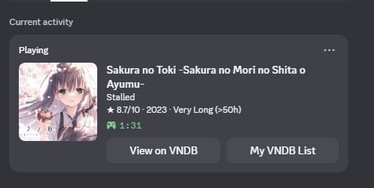
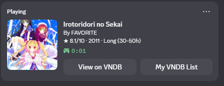
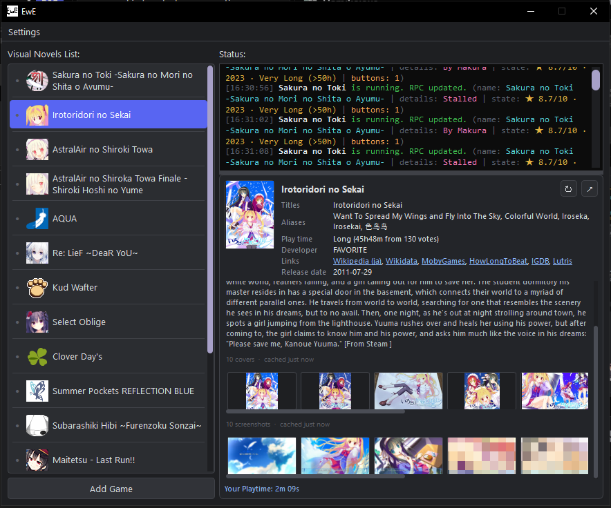
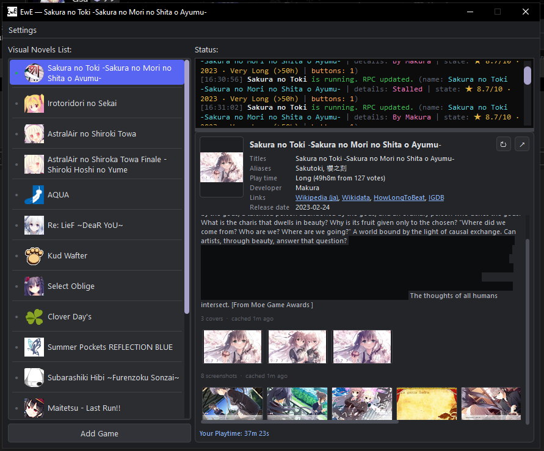
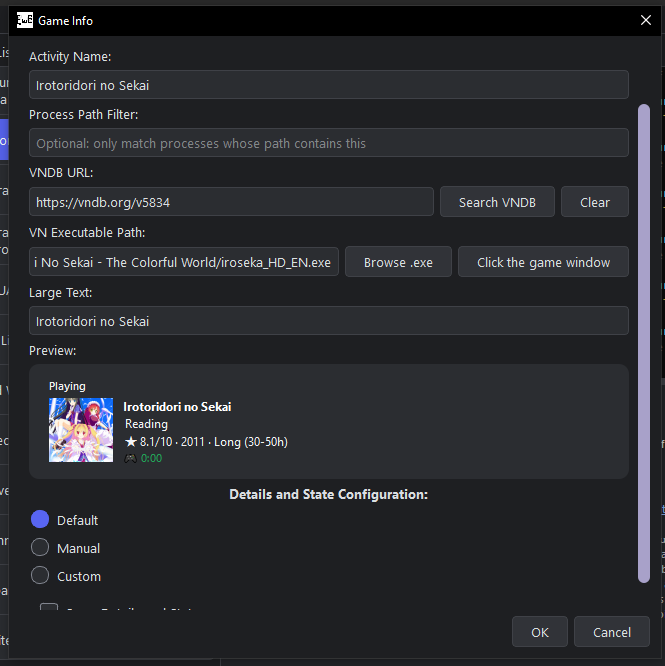
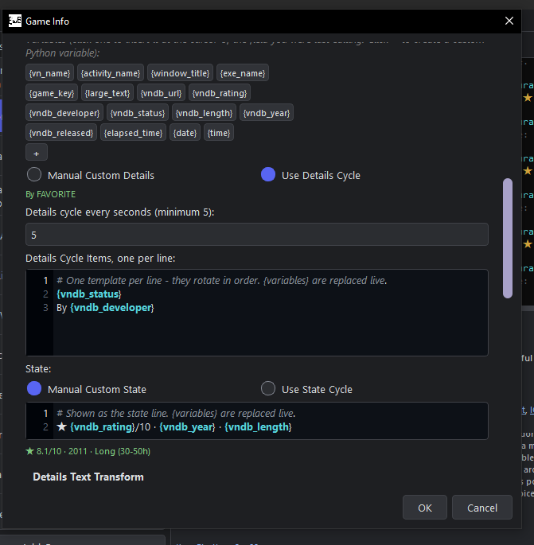

# EwE

This program shows visual novels you currently play in your Discord Activity.

## Install

Download the latest [Release](https://github.com/VaternID/EwE/releases), extract the zip, and run `EwE.exe`. Or just run the program from source.

## Get started

- Open EwE and Startup Guide window will automatically start for first time, just follow it.
- Click **Add Game**.
- Select the game by its running window, `.exe`, or running process.
- Set its name, cover, and presence text, or EwE do it automatically.
- Keep EwE and Discord desktop running.
- Simply launch the game.

## How it works
EwE matches the executable by process name and path and remember related game
processes. If multiple games run, EwE shows one based on their start times.

## Feature
- Minimal Setup
- Highly Customizeable
- Automatically fetching from VNDB
- Built-in Library
- Censor explicit image by default settings (can be turned off).
- Playtime tracking

## Files and settings

EwE stores its files beside the program:

- `settings.json` = user settings.
- `vnlist.json` = your games, playtime, and cached data.
- `Cache\` = downloaded images.
- `Saved\` = covers and icons saved from the program.
- `Custom\` = your custom Python scripts.
- `ewe_crash.log` = crash and error log.

More details: [Configuration Reference](docs/configuration.md) and
[Technical Reference](docs/technical-reference.md).

## Screenshots

Main Window 1 

Main Window 2 

Preview

Custom

## Future Plan
- Detect processes inside emulator
- More Customization 
- Improving the Library
- Improving Perfomance
- More OS Support like Android (Maybe) -> check my friend repo https://github.com/Atho64/VN-Asyik

## License

See [LICENSE](LICENSE).
